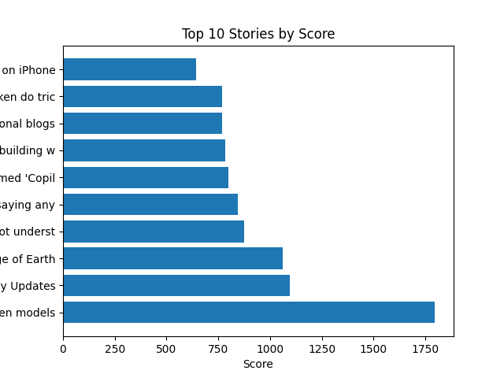
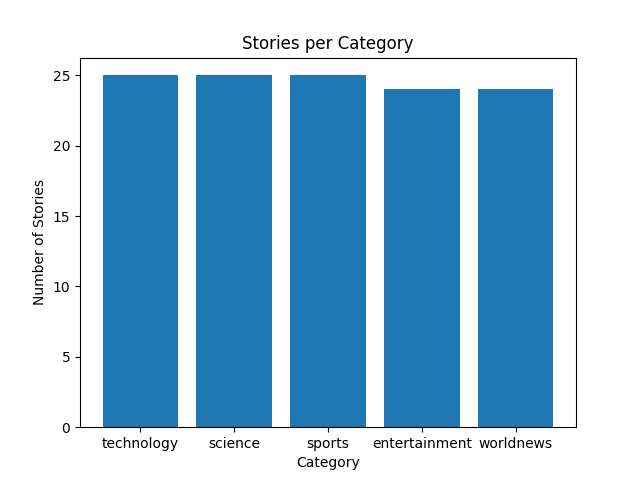
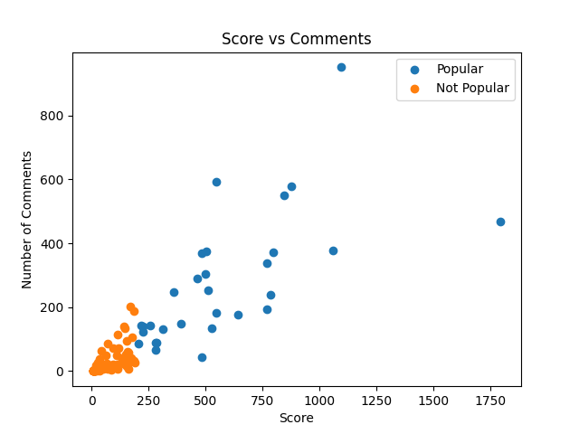
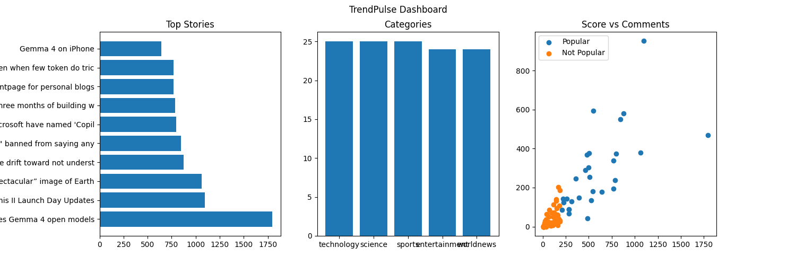

# 📊 TrendPulse – Hacker News Data Analysis

### Discovering Trends Through Data Collection, Cleaning, Analysis, and Visualization

TrendPulse is a data analysis project that I created to explore trending stories on Hacker News. The main goal of this project is to collect story data, organize it into different categories, clean and analyze it using Python, and present the results through easy-to-understand visualizations.

While working on this project, I followed a complete data analysis workflow, starting with data collection and ending with charts and insights. This helped me understand how raw data can be transformed into meaningful information.

---

## 📌 Table of Contents

- [About the Project](#-about-the-project)
- [Project Objectives](#-project-objectives)
- [Tools and Technologies](#-tools-and-technologies)
- [Project Workflow](#-project-workflow)
  - [Data Collection](#-1-data-collection)
  - [Data Cleaning and Processing](#-2-data-cleaning-and-processing)
  - [Exploratory Data Analysis](#-3-exploratory-data-analysis)
  - [Data Visualization](#-4-data-visualization)
- [Key Findings](#-key-findings)
- [Project Structure](#-project-structure)
- [How to Run the Project](#-how-to-run-the-project)
- [What I Learned](#-what-i-learned)
- [Limitations](#-limitations)
- [Future Improvements](#-future-improvements)
- [Conclusion](#-conclusion)

---

## 📖 About the Project

Hacker News is a platform where people share and discuss stories related to technology, science, business, and other topics.

I built TrendPulse to explore these stories and understand how their scores and comment counts differ across categories.

The project uses the Hacker News API to collect story information. I then process the collected data, remove duplicate and incomplete records, perform basic analysis, and create charts to make the results easier to understand.

The project focuses on three main questions:

- Which categories have the highest average story scores?
- Which categories have the most stories scoring above the overall average?
- Which categories receive the most comments and discussion?

By answering these questions, TrendPulse demonstrates how Python can be used to turn raw data into useful insights.

---

## 🎯 Project Objectives

The main objectives of this project are:

- Collect story data from Hacker News using its API.
- Organize stories into categories using keyword-based rules.
- Clean the collected data and handle missing or duplicate records.
- Filter stories based on their scores.
- Calculate summary statistics for different categories.
- Identify stories with scores above the dataset average.
- Study the relationship between story scores and comments.
- Create charts that make the findings easy to understand.
- Practice a complete data analysis workflow using Python.

---

## 🛠️ Tools and Technologies

I used the following tools and technologies to build this project:

| Tool or Technology | Purpose |
|--------------------|---------|
| Python | Writing the scripts and performing data analysis |
| Hacker News API | Collecting story information |
| Pandas | Cleaning, organizing, and analyzing tabular data |
| Matplotlib | Creating charts and visualizations |
| JSON | Storing the collected raw data |
| CSV | Saving the cleaned and analyzed datasets |
| GitHub | Storing and sharing the project |

---

## 🔄 Project Workflow

The project is divided into four main stages. Each stage has its own Python script.

```
Data Collection → Data Cleaning → Data Analysis → Data Visualization
```

1. **Data Collection**
   I collected story information from Hacker News and organized the stories into categories using title-based keywords.

2. **Data Cleaning**
   I removed duplicate records, handled missing values, converted important columns to the correct data types, and filtered out stories with scores below 5.

3. **Data Analysis**
   I calculated average scores and comment counts, compared categories, and identified stories with scores above the average score of the cleaned dataset.

4. **Data Visualization**
   I created individual charts and a combined dashboard to present the results visually.

---

## 📥 1. Data Collection

**Script:** `task1_data_collection.py`

The first step was collecting story data from Hacker News.

I used the Hacker News API to retrieve the IDs of top stories and collect their available information.

The collected data includes:

- **Post ID:** A unique identifier for a story.
- **Title:** The title of the story.
- **Score:** The score received by the story.
- **Number of Comments:** The number of comments associated with the story.
- **Category:** The category assigned to the story by the project's keyword-based rules.

I organized the stories into five categories:

- Technology
- Sports
- Science
- Entertainment
- World News

The collection script limits each category to a maximum of 25 stories. It also attempts to fill categories that have fewer matching stories by assigning otherwise uncategorized stories to categories with available capacity.

The collected data is saved as a JSON file for the next stage of the project.

**Output example:** `trends_20260406.json`

This stage gave me the raw data needed to continue with cleaning and analysis.

---

## 🧹 2. Data Cleaning and Processing

**Script:** `task2_data_processing.py`

Raw data is not always ready for analysis. It may contain duplicate records, missing values, or values stored in an unsuitable format.

To make the dataset more reliable, I performed the following cleaning steps:

1. **Removed duplicate stories:** I removed repeated records based on the post ID.
2. **Handled missing information:** I removed records missing essential fields such as post ID, title, or score.
3. **Processed missing comment counts:** Missing comment counts were filled with `0`.
4. **Converted data types:** Score and comment count values were converted to integers.
5. **Filtered low-scoring stories:** I retained stories with a score of at least `5`.
6. **Cleaned story titles:** I removed unnecessary whitespace from titles.
7. **Saved the cleaned data:** The processed records were saved to a CSV file.

**Output file:** `trends_clean.csv`

After processing, the dataset was ready for analysis.

### Data Cleaning Results

| Metric | Result |
|--------|--------|
| Stories collected | 125 |
| Stories remaining after cleaning | 123 |
| Stories removed by the score filter | 2 |
| Data retained for analysis | 98.4% |

The dataset went from 125 collected stories to 123 stories after cleaning and filtering.

> These results describe the dataset collected on April 6, 2026.

---

## 📈 3. Exploratory Data Analysis

**Script:** `task3_analysis.py`

After cleaning the data, I analyzed the dataset to understand how stories performed across different categories.

The analysis includes the following steps:

- Calculating the average story score.
- Calculating the average number of comments.
- Identifying the category with the most stories.
- Calculating an engagement ratio using comment count and score.
- Identifying stories with scores above the overall average.
- Saving the results for visualization.

### Engagement Calculation

I created an `engagement` column using the following formula:

```
engagement = num_comments / (score + 1)
```

This provides a simple way to compare the number of comments with a story's score. It is a project-specific ratio, not a standard measure of engagement.

### Identifying Popular Stories

I also created an `is_popular` column.

A story is marked as popular when its score is greater than the average score of all stories in the cleaned dataset.

In simple terms:

- `True`: The story's score is above the overall average.
- `False`: The story's score is equal to or below the overall average.

This definition is specific to this project and does not represent an official Hacker News popularity label.

**Output file:** `trends_analysed.csv`

The analyzed dataset contains 123 stories and includes additional columns used to explore story performance.

---

## 📊 4. Data Visualization

**Script:** `task4_visualization.py`

To make the analysis easier to understand, I created three individual charts and one combined dashboard.

### Chart 1: Top 10 Stories by Score

**File:** `chart1_top_stories.png`

This chart displays the ten stories with the highest scores in the analyzed dataset. It helps identify which stories received the highest scores in the collected sample.



### Chart 2: Number of Stories by Category

**File:** `chart2_categories.png`

This chart compares the number of analyzed stories in each category. It provides a quick overview of how the stories are distributed across Technology, Sports, Science, Entertainment, and World News.



### Chart 3: Story Score vs. Number of Comments

**File:** `chart3_scatter.png`

This scatter plot compares story scores with comment counts.

Each point represents a story. Looking at the distribution of points helps explore whether stories with higher scores also tend to receive more comments. However, a scatter plot alone does not establish that one measure causes the other.



### Combined Dashboard

**File:** `dashboard.png`

The dashboard brings the main visualizations together in one place. It makes it easier to compare the top stories, category distribution, and relationship between scores and comments without viewing each chart separately.



---

## 🔍 Key Findings

After collecting, cleaning, and analyzing the data, I identified several interesting patterns in the dataset.

> The findings below are based on 123 analyzed stories collected on April 6, 2026.

### Category-Level Analysis

| Category | Stories Analyzed | Average Score | Average Comments | Popular Stories |
|----------|:---------------:|:-------------:|:----------------:|:---------------:|
| Technology | 25 | 212.96 | 89.76 | 9 |
| Sports | 25 | 243.56 | 91.32 | 7 |
| Science | 25 | 159.68 | 97.64 | 4 |
| Entertainment | 24 | 161.96 | 47.71 | 5 |
| World News | 24 | 168.58 | 103.88 | 5 |
| **Total** | **123** | — | — | **30** |

Average scores and comment counts are rounded to two decimal places. A popular story is one with a score greater than the overall average score of the cleaned dataset.

### 🏆 1. Sports Had the Highest Average Score

Sports had the highest average score among the five categories, at **243.56**.

Within this sample, stories assigned to Sports received higher scores on average than stories in the other categories.

### 💻 2. Technology Had the Most Popular Stories

Technology had **9 popular stories out of 25**, the highest number among the categories.

Here, popular stories are those with scores above the average score of the entire cleaned dataset.

### 💬 3. World News Had the Highest Average Comment Count

World News had an average of **103.88 comments per story**, the highest among the five categories.

This suggests that World News stories in this sample generated more discussion on average.

### 📉 4. Entertainment Had the Lowest Average Comment Count

Entertainment had an average of **47.71 comments per story**, the lowest among the categories.

This shows that the number of comments varied across the categories in the collected dataset.

### 🧹 5. Most Collected Stories Were Retained

Out of the 125 collected stories, 123 remained after cleaning and filtering. This represents a retention rate of **98.4%**.

Only two stories were removed by the score filter, and the final analyzed dataset contained no duplicate post IDs or missing values in the checked columns.

### Summary of Findings

Overall, Sports had the highest average score, Technology had the most stories scoring above the dataset average, and World News had the highest average number of comments.

These findings help illustrate how story scores and discussion levels differed across categories in this particular collection.

> ⚠️ They should not be treated as proof of long-term trends because the analysis is based on a single collection.

---

## 📁 Project Structure

The repository contains the Python scripts, datasets, and visualizations used in the project.

```
trendpulse-project/
│
├── README.md
│
├── task1_data_collection.py
├── task2_data_processing.py
├── task3_analysis.py
├── task4_visualization.py
│
├── trends_20260406.json
├── trends_clean.csv
├── trends_analysed.csv
│
├── chart1_top_stories.png
├── chart2_categories.png
├── chart3_scatter.png
└── dashboard.png
```

### What Each File Does

| File | Description |
|------|-------------|
| `README.md` | Explains the project, workflow, findings, and instructions |
| `task1_data_collection.py` | Collects story data from Hacker News |
| `task2_data_processing.py` | Cleans and filters the collected data |
| `task3_analysis.py` | Calculates statistics and adds analysis columns |
| `task4_visualization.py` | Generates charts and the dashboard |
| `trends_20260406.json` | Stores the collected raw story data |
| `trends_clean.csv` | Contains the cleaned dataset |
| `trends_analysed.csv` | Contains the analyzed dataset |
| `chart1_top_stories.png` | Shows the top ten stories by score |
| `chart2_categories.png` | Compares story counts by category |
| `chart3_scatter.png` | Compares scores and comment counts |
| `dashboard.png` | Combines the main visualizations |

---

## 🚀 How to Run the Project

You can run the project on your local computer using Python.

**Step 1: Clone the repository**

```bash
git clone https://github.com/prernaahire2378-del/trendpulse-project.git
```

**Step 2: Open the project folder**

```bash
cd trendpulse-project
```

**Step 3: Install the required libraries**

```bash
pip install requests pandas matplotlib
```

**Step 4: Run the Python scripts in order**

```bash
# 1. Collect the data
python task1_data_collection.py

# 2. Clean the data
python task2_data_processing.py

# 3. Perform the analysis
python task3_analysis.py

# 4. Generate the visualizations
python task4_visualization.py
```

> **Important:** Each script depends on the appropriate input data from the previous stage. If you run the project on your own computer, check the file paths inside the scripts to make sure they match your folder structure and that each script can find the files generated by the previous stage.
>
> The data collection stage requires an internet connection to access the Hacker News API.

---

## 🎓 What I Learned

Working on TrendPulse helped me practice several important data analysis skills.

1. **Working with APIs:** I learned how to collect data from an API and organize the responses for further processing.
2. **Data Cleaning:** I practiced removing duplicate records, handling missing values, converting data types, and applying filters to prepare data for analysis.
3. **Data Analysis with Pandas:** I used Pandas to calculate averages, compare categories, create additional columns, and summarize the dataset.
4. **Data Visualization:** I learned how to present results through charts and a dashboard so that patterns are easier to understand.
5. **Working with Different Data Formats:** I worked with JSON files for raw data and CSV files for the cleaned and analyzed datasets.
6. **Organizing a Data Analysis Project:** I divided the work into separate Python scripts, with each script responsible for a specific stage of the workflow.
7. **Interpreting Results:** I practiced using data to answer questions, compare categories, and explain findings while recognizing the limitations of the dataset.

---

## ⚠️ Limitations

- **Fallback categorization:** 86 of the 125 collected stories matched none of the title keywords and were assigned to whichever category still had room, so category averages (including Sports at 243.56) compare buckets rather than true topics. Treat them as descriptive only.

Although TrendPulse provides a useful introduction to data analysis, there are a few limitations to keep in mind.

- **Single collection:** The findings represent one collection of stories from April 6, 2026. They may not represent Hacker News activity on other days.
- **Keyword-based categories:** Stories are categorized using keywords in their titles. Some stories may therefore be assigned to an incorrect category.
- **Category limits:** The collection script limits each category to 25 stories, so the dataset is not a complete or necessarily representative sample of all Hacker News stories.
- **Popular-story definition:** Popularity is defined using the average score of the cleaned dataset. This is a project-specific rule rather than an official measure.
- **Engagement calculation:** The engagement column is a simple ratio of comments to score plus one. It does not capture every aspect of audience engagement.
- **No causal conclusions:** Differences in scores and comments do not establish why a story performed the way it did.

These limitations are important when interpreting the results and deciding what conclusions can reasonably be drawn from the analysis.

---

## 🔮 Future Improvements

There are several ways I would like to improve TrendPulse in the future:

- **Collect data over multiple days:** Compare stories across different dates to identify changes over time.
- **Improve categorization:** Use more advanced keyword rules or natural language processing to classify stories more accurately.
- **Add more visualizations:** Explore score distributions, category comparisons, and changes in story performance over time.
- **Improve the engagement analysis:** Compare scores and comments using additional statistical measures.
- **Automate the workflow:** Make it easier to collect, clean, analyze, and visualize new data with fewer manual steps.
- **Build an interactive dashboard:** Allow users to filter stories by category, score, and date.
- **Improve documentation and testing:** Add clearer setup instructions, validation checks, and automated tests to make the project easier to maintain.

These improvements could make the project more useful for exploring Hacker News data and understanding how discussion patterns change over time.

---

## 📝 Conclusion

TrendPulse gave me an opportunity to work through a complete data analysis process, from collecting raw data to presenting the final findings.

By using Python, Pandas, and Matplotlib, I created a workflow that collects Hacker News stories, cleans the data, calculates useful statistics, and presents the results through visualizations.

The analysis found that Sports had the highest average score, Technology had the most stories scoring above the overall average, and World News had the highest average comment count in the collected sample.

More importantly, this project helped me practice data cleaning, exploratory analysis, visualization, and communicating results in a clear and structured way.

I see TrendPulse as a foundation that I can continue to improve by collecting more data, refining the categorization process, and adding more advanced analysis.

---

## 👩‍💻 Project Information

| | |
|---|---|
| **Project Name** | TrendPulse – Hacker News Data Analysis |
| **Language** | Python |
| **Data Source** | Hacker News API |
| **Main Libraries** | Pandas, Matplotlib, Requests |
| **Project Type** | Data Collection, Data Cleaning, Exploratory Data Analysis, and Data Visualization |

**GitHub Repository:** [prernaahire2378-del/trendpulse-project](https://github.com/prernaahire2378-del/trendpulse-project)

---

*Thank you for taking the time to explore my project!*
